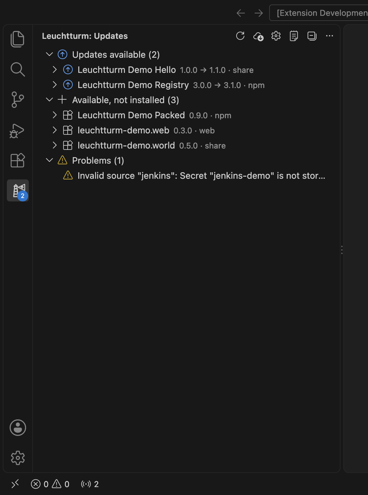
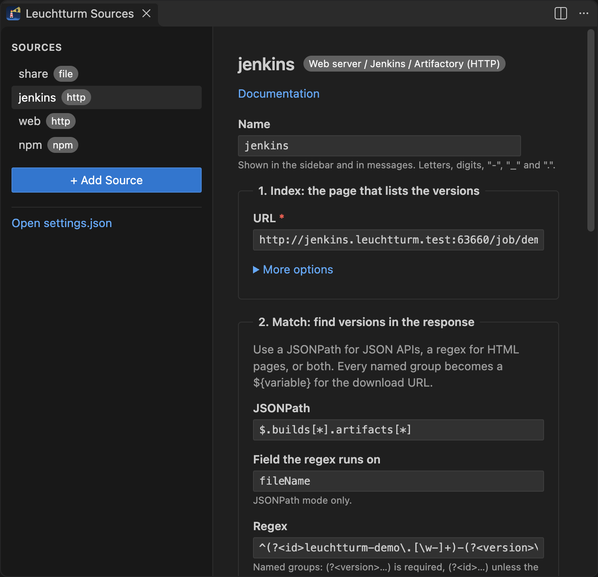

# Leuchtturm Updater

Keeps VS Code extensions that are **not** on the Marketplace up to date. Leuchtturm checks
the sources you configure, tells you when a newer version is available and installs it when you
click _Update_. It never installs anything on its own.

It uses only public VS Code APIs and does not touch VS Code's marketplace configuration.



## Install

Download `leuchtturm-updater-<version>.vsix` from the
[releases](https://github.com/armaxri/LeuchtturmUpdater/releases) and install it with
_Extensions: Install from VSIX…_ (or `code --install-extension <file>`).

The pre-release **Development build (main)** is rebuilt on every change to `main`. It always
reports version 99.99.99, so VS Code and Leuchtturm treat it as newer than every release.

## Quick start

1. Open the Leuchtturm view and click **+** (_Add Source…_).
2. Paste the link where you download the extension today: a Jenkins job or its _Last
   Successful Artifacts_ page, a web page that lists `.vsix` files, or a single `.vsix` link.
   A folder or network share works too (_Choose Folder…_), and so does an npm package name.
3. Leuchtturm shows the extensions and versions it found there. Check the list, keep or change
   the name, and click **Save**. No regex, no JSON.

   

4. Run _Leuchtturm: Check for Updates_. Every installed extension that the share offers is
   now tracked. When a newer version shows up, Leuchtturm notifies you; _Show Updates_ lets you
   pick what to install.

Sources are stored in your user settings (`leuchtturm.sources`), which you can also edit by
hand; _Manage Sources_ opens a detailed form for each one. A `leuchtturm.sources` entry in a
workspace's `.vscode/settings.json` is ignored, so a cloned repository cannot add download
locations.

The `.vsix` file names need a version, as `vsce package` names them: `corp.linter-1.4.1.vsix`.

**Servers that need a login:** Leuchtturm handles no passwords or tokens. Use a
[`script` source](docs/sources/script.md): a small program (from your company, or adapted from
the examples) that signs in and downloads, which Leuchtturm runs. npm registries work with
whatever login npm itself has.

## Commands

| Command                               | What it does                                                                       |
| ------------------------------------- | ---------------------------------------------------------------------------------- |
| Leuchtturm: Check for Updates         | Checks all sources now.                                                            |
| Leuchtturm: Add Source…               | Paste a link (Jenkins, web page, folder, npm name); Leuchtturm sets up the source. |
| Leuchtturm: Manage Sources            | A detailed form per source, with validation and Test.                              |
| Leuchtturm: Update Extension…         | Pick from the available updates and install them.                                  |
| Leuchtturm: Install Specific Version… | Install any offered version, including downgrades (with confirmation).             |
| Leuchtturm: Reset Skipped Versions    | Forget versions skipped from a notification.                                       |
| Leuchtturm: Show Log                  | Opens the "Leuchtturm Updater" output channel.                                     |

## Settings

| Setting                          | Default |                                                                                                                                    |
| -------------------------------- | ------- | ---------------------------------------------------------------------------------------------------------------------------------- |
| `leuchtturm.enabled`             | `true`  | Master switch.                                                                                                                     |
| `leuchtturm.checkInterval`       | `60`    | Minutes between checks; `0` disables periodic checks (minimum 5).                                                                  |
| `leuchtturm.checkOnStartup`      | `true`  | Check about 10 s after startup.                                                                                                    |
| `leuchtturm.notify`              | `true`  | Notify about new updates. There is intentionally no auto-install.                                                                  |
| `leuchtturm.includePrerelease`   | `false` | Consider semver prereleases.                                                                                                       |
| `leuchtturm.sources`             | `{}`    | Named sources (user settings only).                                                                                                |
| `leuchtturm.extensions`          | `[]`    | What to track: `"id"`, `"source:id"` or `{ "id", "source", "pin", "enabled" }`. Empty = every installed extension a source offers. |
| `leuchtturm.trackAllFromSources` | `false` | Also list extensions that are offered but not installed.                                                                           |
| `leuchtturm.http.timeout`        | `30`    | Default timeout in seconds (also used for listing `file` sources).                                                                 |

## Source types

- [`file`](docs/sources/file.md): folder or network share with `.vsix` files.
- [`http`](docs/sources/http.md): Jenkins, web server listings, Artifactory, GitLab/Gitea
  packages, or any page that lists versions (no login); regex or JSONPath matching, generated
  for you by _Add Source_.
- [`npm`](docs/sources/npm.md): any npm registry (Nexus, Artifactory, Verdaccio, …) with
  packages that wrap a `.vsix`; runs your npm with your npm configuration; publishing guide.
- [`script`](docs/sources/script.md): your own program (Python examples included) speaking a
  small JSON protocol, also the way to servers that need a login; off unless enabled in user
  settings, approved once per program.

All settings and variables: [`docs/configuration.md`](docs/configuration.md).
Safeguards and the relation to the VS Code / Marketplace terms: [`docs/security.md`](docs/security.md).

## Remote development

Leuchtturm runs on the **local** machine (`extensionKind: ["ui"]`), where file shares and
internal servers are usually reachable. In Dev Containers, Remote-SSH and WSL windows:

- Your local user settings apply: the same sources and script approvals as in
  local windows. Nothing needs to be configured inside the container.
- Checks and downloads run locally. Installs go through VS Code's own install command, which
  puts each extension where it runs: most extensions on the remote side, UI extensions locally.
- VS Code only tells Leuchtturm about the extensions installed **locally**. For the ones on the
  remote side, Leuchtturm needs a small helper there. The sidebar shows _Extensions installed in
  the dev container are not visible yet_; click it once to install the helper (it ships with
  Leuchtturm; **Leuchtturm: Install Helper in Remote** does the same). A rebuilt container
  needs it again. Without the helper, remote-side extensions show up as _Not installed_.

This is tested automatically in a real Dev Containers window (`npm run test:remote`, needs
Docker). Remote-SSH and WSL use the same mechanism but are not tested automatically.

## Development

```sh
npm install
npm run build             # bundle into dist/extension.js
npm test                  # unit tests (vitest)
npm run test:integration  # end-to-end in a downloaded VS Code
npm run test:remote       # the same demo in a Dev Containers window (needs Docker)
npm run test:ui           # clicks through the source editor with Playwright
npm run test:jenkins      # against a real Jenkins in Docker (pipeline builds new versions)
npm run lint              # eslint + prettier + tsc
npm run sandbox           # open a demo VS Code window (isolated profile, demo share)
npm run sandbox -- --dev-container  # the same, inside a dev container (needs Docker)
npm run full-sandbox      # the sandbox plus a real Jenkins in Docker; "Build Now" makes a new version
npm run screenshots       # re-render docs/images/*.png from the demo scenario
npm run package           # build the .vsix and check its README images
```

`npm run sandbox` rebuilds `.sandbox/` from scratch, with a fake share holding demo extensions
at several versions and an old version pre-installed. It then opens a separate VS Code window
running the development build. `TRY-ME.md` in that window lists what to try. The same scenario
drives the integration tests (`src/test/scenario.ts`).

### Releases

CI (`.github/workflows/ci.yml`) publishes only after all tests passed:

- every push to `main`: the `.vsix` as version 99.99.99 (the version in `package.json`) in the
  pre-release `latest-build`, replacing the previous one;
- a tag `release/x.y.z` (for example `git tag release/1.2.0 && git push origin release/1.2.0`):
  version x.y.z as a GitHub release. The tag sets the version; the release notes are the
  `## x.y.z` section of `CHANGELOG.md` (GitHub's list of changes if there is none).

## License

MIT
